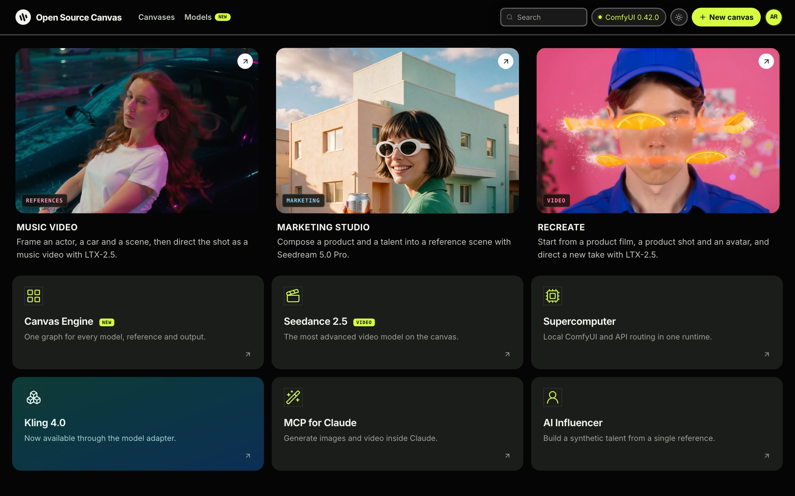
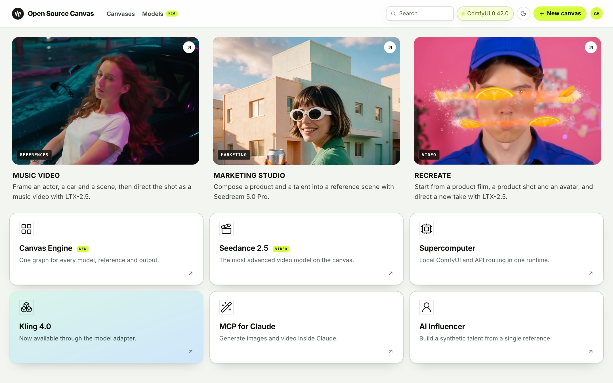
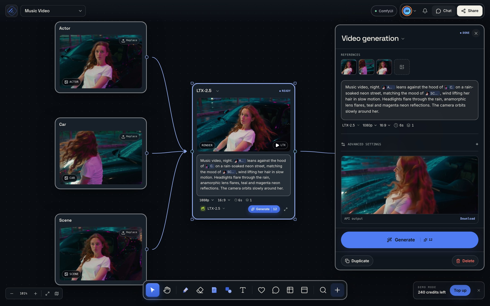
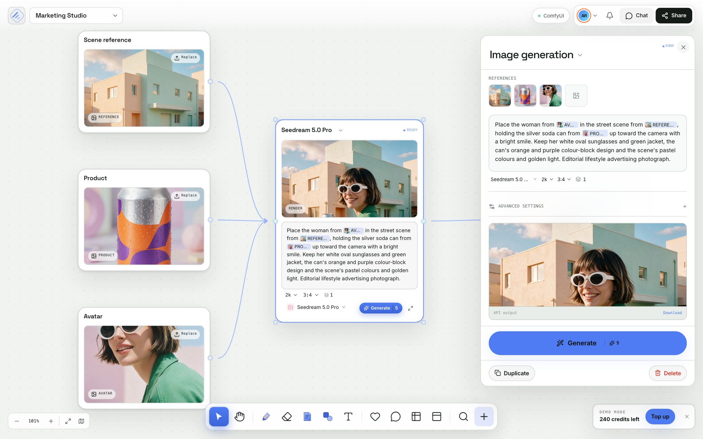
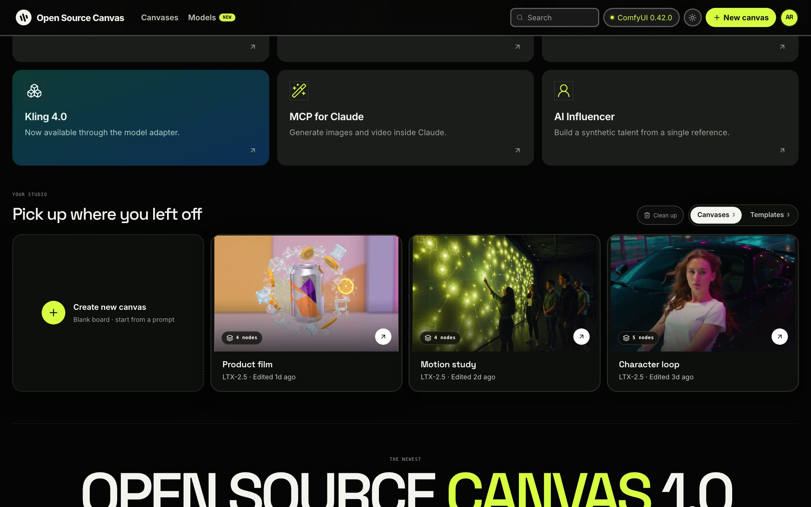

# Open Source Canvas

**The graph is the studio.** An open-source node canvas for generating images and video. Every node is a workflow:
prompts, references and models go in on one infinite board, and finished images and clips come out.

It runs on your own machine against a local [ComfyUI](https://github.com/comfyanonymous/ComfyUI) server, and it can
also reach hosted models through ComfyUI's partner (API) nodes.

- App: React + Vite + React Flow, state in Zustand, all graphs saved as plain JSON in your browser
- Engine: ComfyUI HTTP and WebSocket API (nothing is generated by the front end itself)
- Local models that work out of the box: **SD-Turbo** (images) and **LTX-Video 2B** (video)
- Hosted models via ComfyUI partner nodes: **LTX-2.5**, **Seedream 5.0 Pro** and others (see [API models](#api-models))
- License: MIT (the app). Model weights have their own licenses, see [Model licenses](#model-licenses)
- **Try it in your browser:** [raph651.github.io/open-source-canvas](https://raph651.github.io/open-source-canvas/). Demo only: ComfyUI is offline there, so you can edit canvases and press Run but results are placeholder artwork. Run the app locally for real generation.

<p align="center">
  <a href="docs/media/demo-1080p-v3.mp4"></a>
</p>
<p align="center"><sub>25 s demo. <a href="docs/media/demo-1080p-v3.mp4">Watch it with sound</a> (MP4, 1080p, 23 MB). All footage was generated for this project.</sub></p>

## Screenshots

| | |
|---|---|
|  |  |
| The studio home, night theme | The studio home, day theme |
|  |  |
| Music Video: references into LTX-2.5, delivered as a clip (night theme) | Marketing Studio: references into Seedream 5.0 Pro (day theme) |



The example boards ship with their finished outputs, made with LTX-2.5 and Seedream 5.0 Pro, so a first visit shows what a run produces.

## What you get

- A studio home with example boards and templates (Music Video, Marketing Studio, Recreate, Product film, Motion study, Character loop)
- An infinite canvas with pan, zoom, snap, multi-select, undo and redo, copy and paste, group and ungroup
- Prompt, Image, Model, Output and Note nodes with typed connections (cycles and duplicate edges are rejected)
- Per-node generation panel: prompt, references, model, resolution, aspect, duration, seed
- Image-to-image and image-to-video chains (an upstream image becomes the next node's reference or first frame)
- Compare tray, version history, JSON export, local autosave
- Optional collaboration room (`npm run room`) that syncs a board over WebSocket
- Light and night themes

## Requirements

| | |
|---|---|
| Node.js | 20 or newer (22 is what CI uses), with npm |
| ComfyUI | a recent build (0.40 or newer recommended); see below |
| Hardware | SD-Turbo runs on almost anything, including Apple Silicon (MPS), CUDA and CPU. LTX-Video 2B needs about 24 GB of unified or GPU memory at the default draft size. |
| Disk | about 15 GB for the two local models and the text encoder |

## Quick start

### 1. Get the app

```bash
git clone https://github.com/raph651/open-source-canvas.git
cd open-source-canvas
npm install
```

### 2. Set up ComfyUI

If you already run ComfyUI, skip to step 3.

**Option A, one script.** It clones ComfyUI next to this repo, makes a Python 3.12 environment with
[uv](https://docs.astral.sh/uv/) and downloads the models (about 16 GB free disk for everything):

```bash
./scripts/setup-comfyui.sh --with-video      # images and video (leave the flag off for images only)
```

**Option B, by hand.**

```bash
git clone https://github.com/comfyanonymous/ComfyUI.git comfyui
cd comfyui
python3 -m venv .venv          # Python 3.10 to 3.12
source .venv/bin/activate
pip install -r requirements.txt
```

Install PyTorch for your hardware first if the requirements step does not pick it up
(see the [ComfyUI install guide](https://github.com/comfyanonymous/ComfyUI#installing)).

Download the models the app uses by default (Option A already did this):

| File | Put it in | Used for |
|---|---|---|
| `sd_turbo.safetensors` ([stabilityai/sd-turbo](https://huggingface.co/stabilityai/sd-turbo)) | `ComfyUI/models/checkpoints/` | images |
| `ltxv-2b-0.9.8-distilled-fp8.safetensors` ([Lightricks/LTX-Video](https://huggingface.co/Lightricks/LTX-Video)) | `ComfyUI/models/checkpoints/` | video |
| `t5xxl_fp8_e4m3fn.safetensors` ([comfyanonymous/flux_text_encoders](https://huggingface.co/comfyanonymous/flux_text_encoders)) | `ComfyUI/models/text_encoders/` | the text encoder for LTX |

Start ComfyUI with CORS enabled so the browser app may call it:

```bash
python main.py --enable-cors-header
```

ComfyUI listens on `http://127.0.0.1:8188`. Open that address once to confirm it loads.

### 3. Run the app

```bash
npm run dev        # development: http://127.0.0.1:4173
```

For a production-style run (serves the built app and proxies ComfyUI on the same address, so no CORS flag is needed):

```bash
npm run build
node server/app.mjs        # http://127.0.0.1:4173, ComfyUI proxied at /comfy
```

### 4. Check the connection

Click the **ComfyUI** badge in the top bar. The panel should show `Connected`, your device (`mps`, `cuda` or `cpu`)
and the ComfyUI version. If it says offline, see [Troubleshooting](#troubleshooting).

### 5. Make something

1. Open a template, or choose **New canvas**.
2. Add a **Prompt** node and a **Model** node and drag a line between them.
3. Select the model, write what you want, press **Generate**.
4. For video, connect an image into the video node: it becomes the first frame.

A 512×512 SD-Turbo image takes roughly 10 to 20 seconds on an Apple M-series chip. A short LTX-Video clip at the
default draft size (256×256, 17 frames) takes a minute or two. Turn off **Fast local video** in the ComfyUI panel for
larger clips on a stronger GPU.

## Connecting ComfyUI

The app only needs one thing: the address of a ComfyUI server.

| Setup | What to do |
|---|---|
| Same machine, dev server (`npm run dev`) | Start ComfyUI with `--enable-cors-header`. Keep the default `http://127.0.0.1:8188`. |
| Same machine, built app (`node server/app.mjs`) | Nothing extra. The server proxies `/comfy/*` to ComfyUI, so the browser never talks to it directly. |
| ComfyUI on another machine | Set `COMFY_URL` for the server (below), or change the base URL in the ComfyUI panel. Use HTTPS if it leaves your network. |

Settings in the ComfyUI panel (stored in your browser): base URL, optional API key, the image checkpoint, the video
checkpoint and the text encoder file names, and the **Fast local video** switch.

Server environment variables (`server/app.mjs`):

| Variable | Default | Meaning |
|---|---|---|
| `PORT` | `4173` | port to listen on |
| `HOST` | `127.0.0.1` | bind address |
| `COMFY_URL` | `http://127.0.0.1:8188` | the ComfyUI server to proxy |
| `COMFY_API_KEY` | none | added to proxied requests when ComfyUI sits behind a gateway that needs it |
| `CF_ACCESS_CLIENT_ID`, `CF_ACCESS_CLIENT_SECRET` | none | Cloudflare Access service token, if ComfyUI is behind Access |

The proxy keeps each visitor's outputs separate (outputs are written under a per-client folder) and refuses queue
listings, so a shared deployment does not leak other people's renders.

How a render flows through the code is described in [docs/COMFYUI_RUNTIME.md](docs/COMFYUI_RUNTIME.md). The
workflows themselves are plain ComfyUI API-format JSON in `workflows/`, built in `src/lib/comfyWorkflows.ts`.

## Adding a local model

See [docs/ADDING_MODELS.md](docs/ADDING_MODELS.md): the model entry, its ComfyUI workflow, and how the app checks that its files are installed.

## API models

Some models are not run locally. ComfyUI can call them for you through its **partner nodes**, which run on the
provider's servers and bill your Comfy account credits:

- LTX-2.5 (Fast and Pro), Seedream 5.0 Pro, Nano Banana Pro, Seedance 2.0 and 2.5, Kling, MiniMax H3, Veo, FLUX and more

To use them from ComfyUI:

1. Create a ComfyUI account API key at [platform.comfy.org](https://platform.comfy.org) (API Keys, then New). Add credits.
2. Send your workflow to ComfyUI with the key in `extra_data.api_key_comfy_org` (see the
   [API key integration guide](https://docs.comfy.org/development/comfyui-server/api-key-integration)), or log in
   inside the ComfyUI interface.

**Status in this app:** these models appear in the model list and in the templates, and the example media in this
repo was made with LTX-2.5 and Seedream 5.0 Pro through those nodes. Generating from the canvas with an API model
is not wired yet: it fails with a clear "wrapper required" message instead of faking a render. To add one, register
a wrapper in `src/lib/modelWrappers.ts` that submits the matching partner-node workflow. Keep keys on a server:
never put a key in the browser bundle.

## Project layout

```text
src/
  components/    studio home, canvas editor, nodes, inspector, panels
  lib/           ComfyUI client and provider, workflow builders, model router
  store/         canvas, settings and collaboration state
  data.ts        model catalog and templates
server/
  app.mjs        serves the built app, proxies /comfy, isolates per-visitor outputs
  room.mjs       optional collaboration room
workflows/       API-format ComfyUI graphs (SD-Turbo, LTX)
public/          template media and images
scripts/         setup-comfyui.sh: installs ComfyUI and the models
deploy/          running it for other people behind a Cloudflare Tunnel with Access
docs/            how ComfyUI is used
```

A board is plain JSON: `{ id, title, updatedAt, nodes, edges }`. Boards autosave to your browser; use the canvas menu to
export one.

## Scripts

| Command | What it does |
|---|---|
| `npm run dev` | Vite dev server on port 4173 |
| `npm run build` | type check and production build into `dist/` |
| `npm run preview` | preview the production build |
| `npm run build:pages` | static demo build for GitHub Pages (no ComfyUI, mock provider, notice strip); set `VITE_BASE=/<repo>/` |
| `node server/app.mjs` | serve `dist/` and proxy ComfyUI |
| `npm run room` | collaboration room on port 4180 (in-memory, last write wins, no auth: demo only) |

## Model licenses

The app is MIT. Models are separate:

| Model | License |
|---|---|
| SD-Turbo | Stability AI community license |
| LTX-Video 2B | Lightricks license (see the model card) |
| LTX-2.5 | LTX-2.x Community License. Companies with annual revenue of $10M or more need a commercial license. |
| MiniMax H3 | Community license that excludes the US, EU, UK and South Korea |
| Wan 2.1, Wan 2.2, Mochi 1 | Apache-2.0 |

Read each model card before commercial use. Generated people and products in the examples are synthetic.

## Troubleshooting

- **The badge says offline.** ComfyUI is not running, or the dev server cannot reach it. Start ComfyUI with
  `--enable-cors-header`, or use `node server/app.mjs`, which proxies it. Check the base URL in the ComfyUI panel.
- **`/prompt failed (400)` or "model not found".** A file name in the ComfyUI panel does not match a file in
  `models/checkpoints/` or `models/text_encoders/`. Copy the exact names.
- **Out of memory on video.** Keep **Fast local video** on, use a shorter clip, or run the video node on a machine with more memory.
- **403 from `/comfy/...` on a shared deployment.** Either the proxy refused a request for someone else's output (each visitor only
  sees their own renders), or a gateway in front of it, such as Cloudflare Access, blocked it. See `deploy/README.md`.

## Sharing it with other people

`deploy/README.md` shows how to publish a running copy behind Cloudflare Tunnel and Cloudflare Access, keeping
ComfyUI private on your machine.

## Changes

See [CHANGELOG.md](CHANGELOG.md) for what changed in each version.

## License

MIT. See [LICENSE](./LICENSE). Built with [ComfyUI](https://github.com/comfyanonymous/ComfyUI),
[React Flow](https://reactflow.dev/), React, Vite and Zustand.
